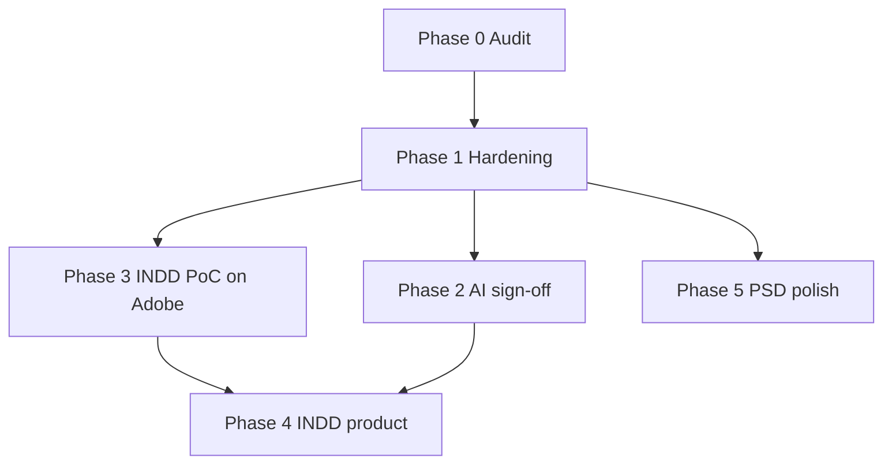

# Creatvise Canvas — Implementation Plan (Post Phase 0 Audit)

**Created:** 2026-10-14  
**Prerequisite:** Approval of `PROJECT-STATUS.md` baseline. **No production INDD/AI scope work should start until approved.**

This plan prioritizes closing assignment gaps for **PSD (hardening)**, **AI (parity + sign-off)**, and **native INDD (PoC → product)**, with explicit acceptance criteria and verification steps.

---

## Guiding principles

1. **Patch-original** export for all formats (preserve unmodeled bytes).
2. **Do not claim native INDD** until PoC-B passes and `.indd` is reopened in InDesign.
3. **IDML-only** editor paths are a stepping stone, not a substitute for native `.indd` assignment language.
4. Extend via **`FormatAdapter`** + **`formatCaps`** (existing Phase 1 pattern).
5. Every phase adds or extends **automated tests** before UI promises.

---

## Phase 1 — Baseline hardening & documentation (1–2 days)

**Goal:** Align docs, caps, and README with code; lock CI-ready npm entry points.

| Task | Depends on | Acceptance criteria | Verification |
|------|------------|---------------------|--------------|
| Update README status matrix for AI (move/resize/OCG/opacity) | Audit approval | Matrix matches `formatCaps.ts` | Diff review |
| Add `test:all` npm script chaining build + test:psd + test:ai + test:folder + test:formats + poc:idml:a | None | Single command; documented in README | Run locally; record exit codes |
| Optional: GitHub Actions workflow running `test:all` (exclude poc:indd:b or mark allowed_failure) | Repo remote | PR checks run tests | CI green on default branch |
| Document deployment (`dist/` static host, IndexedDB, browser matrix) | None | Section in README or DEPLOY.md | Peer review |

**Effort:** S (small). **Risk:** Low.

---

## Phase 2 — AI assignment completion (1–2 weeks)

**Goal:** Close documented AI gaps or explicitly defer with UI + caps; obtain Illustrator sign-off.

### 2A — Verification gate (blocked on Adobe Illustrator)

| Task | Depends on | Acceptance criteria | Verification |
|------|------------|---------------------|--------------|
| Execute FINDINGS-AI §7 manual checklist on `sample.ai` and `DarkTech_Screen.ai` | Illustrator license | Checklist recorded in FINDINGS-AI with version/build | Screenshots or log + dated appendix |
| Tier-0 export (no edits) opens without repair | Same | No repair dialog | Manual |
| Post-edit export (move, rename, opacity) remains editable where expected | Phase E code | Layers editable in Illustrator for OCG file | Manual |

**Effort:** XS (manual hours). **Risk:** Medium — PDF stream edits may invalidate AIPrivate cache (export already clears cache per `test:ai` notes).

### 2B — Feature parity decisions (pick scope with stakeholder)

| Feature | Current | Options | Suggested priority |
|---------|---------|---------|-------------------|
| Duplicate layer | Off | Implement PDF/OCG duplicate or keep blocked | P2 |
| Text edit | Off | High — requires AIPrivate or PDF text ops | P3 (large) |
| Shape fill | Off | PDF path patch | P3 |
| Masks / blends | Off | Render-only + export note | P4 (defer) |
| DarkTech multi-layer | Fallback | AIPrivate spike | P4 |

**Acceptance (minimum for “AI milestone done”):**

- `npm run test:ai` and `test:formats` pass.
- Manual Illustrator checklist **passed** for Tier 0–2 operations on `sample.ai`.
- `formatCaps` and panel UI reflect true capabilities (no README “Roadmap” for shipped features).

**Effort:** M–L depending on text/AIPrivate scope. **Risk:** High for AIPrivate; Low for caps/doc alignment.

---

## Phase 3 — INDD PoC completion on Adobe machine (2–5 days, external dependency)

**Goal:** Prove native round-trip before any browser integration.

| Step | Depends on | Acceptance criteria | Verification |
|------|------------|---------------------|--------------|
| Install Adobe InDesign (desktop CC) on Windows or macOS | Adobe license | `findIndesign.ts` locates exe + COM (Win) or equivalent on macOS | `npm run poc:indd:b` step logs |
| Run `npm run poc:idml:a` | Fixture | Exit 0 | Existing |
| Run `poc-a-verify-indesign.jsx` on `plain.edited.idml` | InDesign | `INDESIGN_OPEN_RESULT=PASS` in `artifacts/poc/poc-a/indesign-open-result.txt` | Manual script |
| Run `npm run poc:indd:b` full orchestrator | InDesign | Exit 0; `poc-b-summary.json` `"pass": true`, `"nativeInddSupported": true` | Automated + artifact paths |
| **Reopen** `artifacts/poc/poc-b/step3-roundtrip.indd` in InDesign | Human | Document opens; TextFrame `uf3` reflects +20/+15 pt patch; no unexpected repair | Visual + DOM/script readback |
| Re-export IDML from roundtrip INDD and diff structure | Optional | Spread XML contains patched transform | Node validator |

**Effort:** S once InDesign is installed. **Risk:** Medium — JSX timeouts, version-specific IDML DOMVersion.

**If PoC-B fails after InDesign install:** Debug step1/step3 logs in `artifacts/poc/poc-b/`; do not proceed to Phase 4.

---

## Phase 4 — INDD product architecture (3–6 weeks)

**Goal:** Production path for assignment “native INDD” with honest limits.

### Recommended architecture (decision point)

| Approach | Pros | Cons | Native `.indd` claim |
|----------|------|------|----------------------|
| **A. Browser IDML editor + server/InDesign export** | Matches PoC; patch in TS | Needs InDesign Server or desktop automation for `.indd` bytes | Yes, if export produces verified `.indd` |
| **B. Browser-only IDML import/export** | No Adobe at runtime | Users get `.idml`, not `.indd` | **No** — fails assignment strict reading |
| **C. Hybrid: import IDML; export asks user to “Save as INDD” via linked helper app** | Clear UX | Extra install | Partial |

**Suggested default:** Approach **A** for export; import via **IDML extraction** (InDesign export on ingest) or direct IDML if user provides `.idml` — **`.indd` import** requires Step 1 JSX equivalent (local helper or cloud worker with InDesign).

### Implementation slices

| Slice | Deliverables | Acceptance criteria | Tests |
|-------|--------------|---------------------|-------|
| 4.1 — Port `idmlPatch.ts` into `src/formats/idml/` (or shared util) | Load/validate/patch IDML in browser (JSZip) | Same transforms as PoC-A on fixture | Port PoC-A assertions to `test:idml` |
| 4.2 — `idmlAdapter` + model backing (`Doc.indd?` / `Doc.idml?`) | Registry registers `idml`; optional `indd` import via pre-conversion | `importDocument` works for IDML; caps defined | Extend `format-registry.test.ts` |
| 4.3 — Scene graph from IDML (minimal) | Spreads → page items as nodes | Canvas shows pages/spread bounds; selection of patched frame | Fixture-based render test |
| 4.4 — Export IDML from app | Non-destructive patch of `ItemTransform`, text, etc. | Byte-level patch tests; structure validator | Automated |
| 4.5 — Native `.indd` export bridge | Node script or InDesign Server job triggered from UI download | Output `.indd` passes PoC-B-equivalent check | `poc:indd:b` pattern reused |
| 4.6 — UI: replace “Coming Soon” for `.indd` | Clear messaging: import requires conversion or IDML | User sees actionable path | Manual UX |
| 4.7 — IndexedDB format branch | Persist original IDML/INDD bytes + deltas | Reload restores edits | Integration test |

**Effort:** L–XL. **Risk:** High — licensing, automation reliability, macOS vs Windows JSX paths.

**Phase 4 exit criteria (native INDD):**

1. User can open assignment-relevant INDD workflow end-to-end **or** documented supported workflow (e.g. upload IDML + download verified INDD).
2. PoC-B (or production equivalent) passes on release machine.
3. Exported `.indd` verified in InDesign after app edit (same as Phase 3 human gate).

---

## Phase 5 — PSD polish & ops (ongoing, P2)

| Task | Acceptance | Verification |
|------|------------|--------------|
| Run `psd:baseline` / `psd:inventory` on release fixtures | Report archived | npm scripts |
| Bundle splitting for pdf.worker + three | Main chunk &lt; 500 kB or documented | `vite build` |
| Playwright smoke for open PSD + export | 1–2 happy paths | New `test:e2e` script |

**Effort:** M. **Risk:** Low.

---

## Dependency graph (summary)

---

## Effort summary (rough)

| Phase | Effort | External deps |
|-------|--------|---------------|
| 1 Hardening | 1–2 d | None |
| 2 AI completion | 3–10 d | Adobe Illustrator (manual) |
| 3 INDD PoC sign-off | 0.5–2 d | Adobe InDesign |
| 4 INDD product | 15–30 d | InDesign / Server for `.indd` bytes |
| 5 PSD/ops | 3–5 d | Optional Photoshop for baseline |

---

## Verification checklist before marking assignment complete

- [ ] `npm run build` — pass  
- [ ] `npm run test:psd` — pass  
- [ ] `npm run test:ai` — pass  
- [ ] `npm run test:formats` — pass  
- [ ] `npm run test:folder` — pass  
- [ ] Illustrator manual checklist — pass (recorded)  
- [ ] `npm run poc:idml:a` — pass  
- [ ] `npm run poc:indd:b` — pass on InDesign machine  
- [ ] Reopen exported `.indd` in InDesign — pass (human)  
- [ ] App import/export for INDD/IDML per agreed architecture — pass  
- [ ] README/caps match shipped behavior  

---

## Awaiting approval

Stop here per Phase 0 instructions. Confirm:

1. Target INDD architecture (**A / B / C** above).  
2. Minimum AI scope (manual sign-off only vs text editing).  
3. Whether to add CI in Phase 1.  

After approval, implementation should begin with **Phase 3** (if InDesign access exists) or **Phase 2A** (Illustrator checklist) in parallel with **Phase 1** doc/CI tasks.
