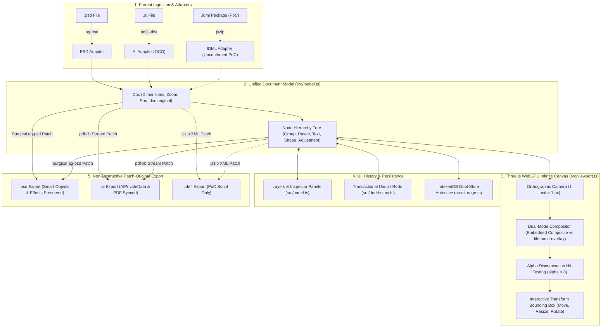

# Creatvise Canvas — WebGPU High-Performance Studio

> High-performance infinite canvas built with **Three.js (`WebGPURenderer`)** and **TypeScript** for importing, viewing, editing, and exporting professional design formats: **Adobe Photoshop (`.psd`)** and **Adobe Illustrator (`.ai`)**, with **Adobe InDesign (`.indd` / `.idml`)** currently in an unconfirmed research / PoC phase.

Creatvise Canvas is engineered on a **non-destructive "patch-original" architecture**: rather than regenerating complex design files from scratch or flattening them to simple bitmaps, it surgically patches modified properties (positions, text, fills, visibility, opacity, marked content) back into the original file structures. All un-modeled native structures—including smart objects, layer effects, vector masks, and proprietary application metadata (`AIPrivateData`, Photoshop descriptors)—remain 100% intact.

---

## Format Deep-Dive Guides

For exhaustive architectural specifications, mathematical formulas, and format-specific pipelines, refer to the dedicated format guides:

- 📄 **[PSD.md](PSD.md)** — Adobe Photoshop: Embedded composite vs `file-base-overlay` preview engine, 9 adjustment layer simulation algorithms, 10+ custom blend modes, clipping/masks, hit-testing, and `ag-psd` non-destructive export.
- 📄 **[AI.md](AI.md)** — Adobe Illustrator: PDF stream parsing (`pdfjs-dist`), Optional Content Groups (OCG), transform matrix (`cm`) patching, `/ExtGState` opacity, marked-content duplicate export, and `pdf-lib` pipeline.
- 📄 **[INDD.md](INDD.md)** — Adobe InDesign *(Unconfirmed / Not Implemented in App)*: Binary format challenges, IDML XML architecture, standalone PoC findings, and future roadmap. Once implemented, this guide will be updated.

---

## Quickstart & How to Run

### Prerequisites
- **Node.js 18+** (tested on Node 20 / 22)
- Modern web browser with **WebGPU** support (Chrome 113+, Edge 113+) or WebGL2 fallback.

### Installation & Development Server

```bash
# 1. Install dependencies
npm install

# 2. Start local Vite development server
npm run dev

# 3. Type-check and build production bundle
npm run build

# 4. Preview production build locally
npm run preview
```

Open the printed localhost URL in Chrome or Edge (e.g. `http://localhost:5173/`).

---

## Test Suites & Benchmarks

The project includes automated regression suites, benchmarks, and baseline scripts:

```bash
# Run all core regression suites (build + formats + folder + AI + PSD)
npm run test:all

# Run all PSD regression scripts (28 chained test suites)
npm run test:psd

# Run Illustrator (.ai) tests (roundtrip, fidelity, selection, opacity, duplication, text)
npm run test:ai

# Test Illustrator shape detection, stroke, and fill color patching
npm run test:ai:shapes

# Run format registry capability checks (56 checks)
npm run test:formats

# Run recursive folder import and classification tests
npm run test:folder

# Profile adjustment layer computation & caching performance
npm run psd:bench

# Report luminance agreement baseline against Photoshop embedded composites
npm run psd:baseline

# Inspect supported and unsupported features in PSD fixtures
npm run psd:inventory

# Run PoC-A: IDML automated unzip, patch, and repack test
npm run poc:idml:a

# Run PoC-B: Native INDD desktop orchestrator (requires Adobe InDesign)
npm run poc:indd:b
```

---

## System Architecture



### 1. Unified Document Model (`src/model.ts`)
A format-agnostic scene graph representation:
- **`Doc`**: Canvas document containing width, height, offset, zoom, original untouched binary bytes (`doc.original`), format metadata, and root node tree.
- **`Node`**: Recursive tree element supporting `group`, `raster`, `text`, `shape`, and `adjustment` types. Each node references its underlying format handle (e.g., `ag-psd` layer or PDF content stream) to enable surgical re-export.

### 2. Three.js WebGPU Infinite Canvas Viewport (`src/viewport.ts`)
- Rendered using Three.js with an orthographic camera where **1 canvas unit = 1 pixel**.
- Layers are textured quads rendered in back-to-front depth order.
- Pixel-accurate canvas hit-testing (`src/canvasHitTest.ts`): ignores transparent pixels ($\alpha \le 8$) and $0\%$ opacity placeholders, enabling natural click-to-select directly on the stage.
- Interactive bounding box with drag-to-move, 8-point resize handles, and top rotation anchor.

### 3. Non-Destructive "Patch-Original" Pipeline
- **PSD Export (`src/psd.ts`)**: Patches layer names, coordinates, opacities, visibility, point text, and shape fills into the in-memory `ag-psd` structure. Smart objects, vector masks, and layer effects remain 100% intact.
- **AI Export (`src/aiPdfLib.ts`)**: Applies vector transformations (`cm` matrix), opacity dictionaries (`/ExtGState`), and duplicate marked-content blocks (`/MCn BDC`) using `pdf-lib` while safely retaining Illustrator-native `AIPrivateData` streams.
- **IDML Export (`scripts/poc/`)**: Standalone PoC script demonstrating XML story node and geometry updates, repacked with an uncompressed `mimetype` at offset 0 (not in production app).

### 4. Dual-Store Persistence & Autosave (`src/storage.ts`)
- **Dual-Store IndexedDB Engine**:
  - `files` store: Stores raw, unmutated binary bytes of open documents.
  - `workspace` store: Stores lightweight delta records (layer transforms, text edits, fills, canvas pan/zoom).
- **Debounced Autosave (600ms)**: Real-time save status indicator in the top navigation bar (`All changes saved`, `Saving…`, `Unsaved changes…`).
- **Safe Session Restore**: Replays saved edits on top of stored originals upon browser reload—preventing destructive bakes.

---

## Cross-Format Status Matrix

| Capability | Adobe Photoshop (`.psd`) | Adobe Illustrator (`.ai`) | Adobe InDesign (`.indd` / `.idml`) *(Unconfirmed / Not in App)* |
|---|:---:|:---:|:---:|
| **File Import** | **Works** (`ag-psd`) | **Works** (PDF-compatible `.ai`) | **Not in App** (App blocks `.indd`; PoC script for IDML) |
| **Folder / Batch Import** | **Works** (recursive traversal) | **Works** (recursive traversal) | Not implemented |
| **Infinite Canvas Rendering** | **Three.js WebGPU / WebGL2** | **Three.js WebGPU / WebGL2** | Not implemented |
| **Layer Tree & Selection Panel** | **Works** (full hierarchy) | **Works** (OCG layers; flat fallback) | Not implemented |
| **Canvas Hit-Test (Alpha > 8)** | **Works** (smallest-area tie-break) | **Works** (rendered alpha mask) | Not implemented |
| **Interactive Move / Pan** | **Works** | **Works** (`cm` matrix patch) | Not implemented |
| **Interactive Resize & Rotate** | **Works** | **Works** (`cm` matrix patch) | Not implemented |
| **Layer Visibility Toggle** | **Works** | **Works** (OCG `/OFF` catalog patch) | Not implemented |
| **Layer Opacity Slider** | **Works** (live scrub) | **Works** (`/ExtGState` `/ca` patch) | Not implemented |
| **Layer Duplication (`Ctrl+D`)** | **Works** | **Works** (Marked-content clone) | Not implemented |
| **Layer Delete** | **Works** | **Works** (omitted on export) | Not implemented |
| **Point Text Editing** | **Works** (`TySh` engine preserved) | Roadmap (PDF text stream patch) | **PoC script only** (`Story_*.xml` patch) |
| **Solid Shape Fill / Stroke** | **Works** (`vscg` descriptor) | **Works** (detected rects `rg`/`RG`) | **PoC script only** (`Graphic.xml` patch) |
| **Adjustment Layers (9 Types)** | **Works** (9 simulated, B/C panel) | N/A | N/A |
| **Layer Effects (Drop Shadow/Glow)** | **Works** (preview & export intact) | N/A | N/A |
| **Undo / Redo History** | **Works** (transactional stack) | **Works** (transactional stack) | Not implemented |
| **Autosave & Session Restore** | **Works** (IndexedDB dual-store) | **Works** (IndexedDB dual-store) | Not implemented |
| **Non-Destructive Patch Export** | **Works** (`ag-psd` patch) | **Works** (`pdf-lib` patch) | **PoC script only** (`jszip` patch) |

---

## Keyboard Shortcuts & Canvas Controls

| Action | Shortcut / Gesture | Description |
|---|---|---|
| **Pan Canvas** | `Spacebar` + Drag / Middle Mouse Drag | Pan across the infinite canvas stage |
| **Zoom Canvas** | Mouse Wheel / Floating HUD controls | Zoom in and out centered on cursor position |
| **Select Layer** | Left Click on canvas or Layers Panel | Selects top-most visible layer pixel ($\alpha > 8$) |
| **Move Layer** | Left Click + Drag on selected layer | Move layer in canvas coordinates |
| **Transform Layer** | Drag selection bounding box handles | Resize from corners/edges, rotate via top handle |
| **Proportional Scale** | Hold `Shift` while dragging corner handle | Maintains layer aspect ratio |
| **Duplicate Layer** | `Ctrl + D` | Duplicates selected layer |
| **Delete Layer** | `Delete` / `Backspace` | Removes selected layer |
| **Undo / Redo** | `Ctrl + Z` / `Ctrl + Y` (or `Ctrl + Shift + Z`) | Step backward or forward in history |
| **Rename Layer** | Double-click row in Layers panel | Edit layer name inline |
| **File Drag & Drop** | Drop PSD/AI files or folders onto stage | Imports documents directly to canvas |

---

## Project Structure

```
creatvise_canvas/
├── README.md               # Main project documentation & quickstart
├── PSD.md                  # Deep dive: Photoshop engine, adjustments, compositing & export
├── AI.md                   # Deep dive: Illustrator engine, OCG layers, PDF streams & export
├── INDD.md                 # Deep dive: InDesign challenges, IDML architecture & PoC results
├── public/                 # Static test fixtures (sample.ai, DarkTech_Screen.ai, 11330937.psd)
│   └── fixtures/           # Synthetic and PoC test assets (IDML, AI shapes, synthetic text)
├── scripts/                # 38+ automated test suites, benchmarks & baseline scripts
│   ├── poc/                # InDesign / IDML PoC-A and PoC-B scripts
│   ├── psd-adjustment-*.test.ts   # Regression tests for all 9 adjustment layers
│   ├── psd-clipping.test.ts       # Clipping mask isolation tests
│   ├── psd-composite-rule.test.ts # Embedded vs 2D compositor decision rules
│   ├── ai-export-roundtrip.test.ts# Illustrator export fidelity tests
│   ├── ai-duplicate-export.test.ts# Illustrator layer duplication tests
│   └── folder-import.test.ts      # Recursive folder traversal tests
├── src/
│   ├── ai.ts               # Illustrator parser (pdfjs-dist OCG extraction)
│   ├── aiPdfLib.ts         # Illustrator patch exporter (pdf-lib)
│   ├── aiVectorShapes.ts   # Detection and color patching for PDF vector paths
│   ├── canvasHitTest.ts    # Direct stage hit-testing & smallest-area selection
│   ├── docHistory.ts       # Transactional document history stack
│   ├── edit.ts             # Layer property mutations & transform helpers
│   ├── folderImport.ts     # Directory scanner & batch file classifier
│   ├── formatCaps.ts       # Per-format capability declarations
│   ├── formats/            # Extensible format adapter registry (PSD, AI)
│   ├── model.ts            # Canonical Document & Node data models
│   ├── panel.ts            # UI Layers panel, inspector & adjustment sliders
│   ├── psd.ts              # PSD file import & non-destructive export (ag-psd)
│   ├── psdAdjustment.ts    # Unified adjustment layer pipeline & dispatch
│   ├── psdAdjustment*.ts   # Specialized adjustment algorithms (Curves, HueSat, CB, BW, LUT, Vib)
│   ├── psdBlend.ts         # Custom per-pixel blend mode mathematics
│   ├── psdComposite.ts     # Composite restack & file-base-overlay dirty patcher
│   ├── psdLayerEffects.ts  # Drop Shadow, Outer Glow, and Stroke renderers
│   ├── storage.ts          # IndexedDB persistence (files & workspace stores)
│   ├── viewport.ts         # Three.js WebGPURenderer stage & orthographic camera
│   └── main.ts             # Application controller & event orchestration
├── package.json            # Project dependencies & npm run scripts
├── tsconfig.json           # TypeScript configuration
└── vite.config.ts          # Vite build configuration
```

---

## License

Private project &copy; Creatvise. All rights reserved.
