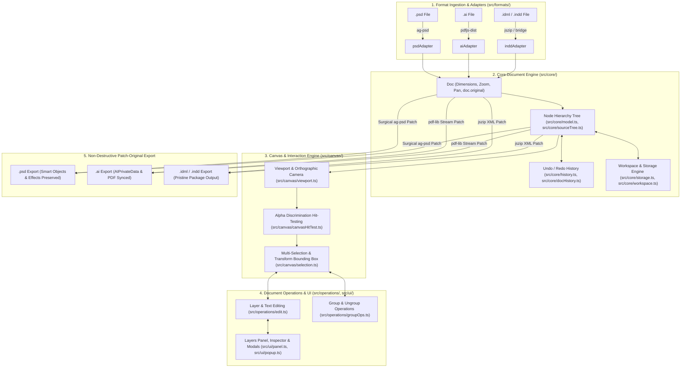

# Creatvise Canvas — WebGPU High-Performance Studio

> High-performance infinite canvas built with **Three.js (`WebGPURenderer`)** and **TypeScript** for importing, viewing, editing, and exporting professional design formats: **Adobe Photoshop (`.psd`)**, **Adobe Illustrator (`.ai`)**, and **Adobe InDesign (`.indd` / `.idml`)**.

Creatvise Canvas is engineered on a **non-destructive "patch-original" architecture**: rather than regenerating complex design files from scratch or flattening them to simple bitmaps, it surgically patches modified properties (positions, text, fills, visibility, opacity, marked content) back into the original file structures. All un-modeled native structures—including smart objects, layer effects, vector masks, and proprietary application metadata (`AIPrivateData`, Photoshop descriptors, InDesign stories)—remain 100% intact.

---

## Format Deep-Dive Guides

For exhaustive architectural specifications, mathematical formulas, and format-specific pipelines, refer to the dedicated format guides:

- 📄 **[PSD.md](PSD.md)** — Adobe Photoshop: Embedded composite vs `file-base-overlay` preview engine, 9 adjustment layer simulation algorithms, 10+ custom blend modes, clipping/masks, hit-testing, and `ag-psd` non-destructive export.
- 📄 **[AI.md](AI.md)** — Adobe Illustrator: PDF stream parsing (`pdfjs-dist`), Optional Content Groups (OCG), transform matrix (`cm`) patching, `/ExtGState` opacity, live text editing, placed image replacement, marked-content duplicate export, and `pdf-lib` pipeline.
- 📄 **[INDD.md](INDD.md)** — Adobe InDesign: Native IDML package parsing (`jszip`), sharp text typography rasterization, 6-element affine matrix transforms, desktop automation bridge (`server/index.mjs`), status indicator chip, and XML non-destructive patch export.

---

## Quickstart & How to Run

### Prerequisites
- **Node.js 18+** (tested on Node 20 / 22 / 24)
- Modern web browser with **WebGPU** support (Chrome 113+, Edge 113+) or WebGL2 fallback.
- *(Optional)* Adobe InDesign Desktop (for `.indd` native conversion bridge).

### Installation & Development Server

```bash
# 1. Install dependencies
npm install

# 2. Start local Vite development server
npm run dev

# 3. Type-check and build production bundle
npm run build

# 4. Preview production build locally
npm run preview

# 5. Start optional InDesign Desktop middleware server (port 3001)
npm run server
```

Open the printed localhost URL in your browser (e.g. `http://localhost:5173/`).

---

## Test Suites & Benchmarks

The project includes automated regression suites, benchmarks, and baseline scripts:

```bash
# Run all core regression suites (build + formats + folder + AI + PSD)
npm run test:all

# Run all PSD regression scripts (28 chained test suites)
npm run test:psd

# Run Illustrator (.ai) tests (roundtrip, fidelity, selection, opacity, duplication, text)
npm run test:ai

# Test Illustrator shape detection, stroke, and fill color patching
npm run test:ai:shapes

# Run InDesign / IDML test suites (33 tests including typography, transforms, swatches)
npm run test:idml

# Run Phase 5 IDML package integrity tests
npm run test:idml:phase5

# Run InDesign desktop middleware health & conversion tests
npm run test:indesign

# Run format registry capability checks (60 checks + cross-format color tests)
npm run test:formats

# Run recursive folder import and classification tests
npm run test:folder

# Profile adjustment layer computation & caching performance
npm run psd:bench
```

---

## System Architecture



---

## Modular Directory Structure (`src/`)

```
src/
├── ai/                     # Adobe Illustrator & PDF Engine
│   ├── index.ts            # Public barrel export
│   ├── ai.ts               # Master AI import & export pipeline
│   ├── aiPdfLib.ts         # PDF stream manipulation via pdf-lib
│   ├── aiPdfText.ts        # PDF live text decoding & streams
│   ├── aiPdfImages.ts      # Embedded PDF raster image extractor
│   ├── aiVectorShapes.ts   # Vector path parsing & shape rendering
│   ├── aiOcgOrderImport.ts # Optional Content Groups (OCG) order resolver
│   ├── aiGroupOps.ts       # AI grouping / ungrouping commands
│   ├── aiReorder.ts        # AI layer reordering
│   ├── aiLayerMeta.ts      # AI metadata & marked content duplication
│   ├── aiImageEdit.ts      # Placed image replacement
│   └── aiTextEdit.ts       # Live text editing synchronization
│
├── canvas/                 # Viewport, Stage & Interaction Engine
│   ├── index.ts            # Public barrel export
│   ├── viewport.ts         # Three.js stage, zoom, pan, screenToWorld
│   ├── selection.ts        # Multi-selection, bounding boxes, drag transforms
│   ├── canvasHitTest.ts    # Stage raycasting & alpha discrimination
│   └── fps.ts              # FPS tracker & performance monitor
│
├── core/                   # Document Engine & State Persistence
│   ├── index.ts            # Public barrel export
│   ├── model.ts            # Canonical Doc, Node, and tree traversal models
│   ├── sourceTree.ts       # Layer hierarchy mutations & sibling reordering
│   ├── history.ts          # Command pattern undo/redo stack
│   ├── docHistory.ts       # Multi-document tab management
│   ├── workspace.ts        # Workspace serialization & restoration
│   └── storage.ts          # LocalStorage persistence & cache
│
├── formats/                # Format Adapter Registry & Ingestion Pipeline
│   ├── index.ts            # Registry instance & format dispatchers
│   ├── registry.ts         # Extensible plugin adapter registry
│   ├── formatCaps.ts       # Capabilities matrix & blocked reasons
│   ├── formatImport.ts     # Multi-format import dispatcher
│   ├── formatExport.ts     # Multi-format export dispatcher
│   ├── folderImport.ts     # Recursive directory picker & batch scanner
│   ├── backend.ts          # InDesign bridge communication & health
│   ├── psdAdapter.ts       # Photoshop format adapter
│   ├── aiAdapter.ts        # Illustrator format adapter
│   └── inddAdapter.ts      # InDesign format adapter
│
├── indd/                   # Adobe InDesign & IDML Engine
│   ├── index.ts            # Public barrel export
│   ├── idml.ts             # Top-level IDML import / export orchestrator
│   ├── idmlEdit.ts         # Layer editability, transforms & rasterization
│   ├── idmlRotatePointer.ts# Interactive rotation pointer tracking
│   ├── idmlVisualRotation.ts# CSS & Three.js visual rotation math
│   ├── inddImportReport.ts # Import report generator & downloads
│   ├── indesignStatus.ts   # InDesign middleware health state & status chip
│   ├── exportPatch.ts      # Surgical XML spread & story patcher
│   ├── linkImageFormat.ts  # Linked asset MIME detection
│   ├── matrix.ts           # 6-element 2D affine matrix math
│   ├── objectStyles.ts     # Object style fill & stroke resolvers
│   ├── placedImage.ts      # Placed image placeholder & previews
│   ├── rasterText.ts       # Sharp typography text rasterizer
│   ├── storyExport.ts      # Story XML serializer
│   ├── storyParse.ts       # CharacterStyleRange XML parser
│   ├── swatches.ts         # Swatch definitions & color models
│   ├── textFrameParse.ts   # Text frame boundary parser
│   ├── textLayout.ts       # Font layout & line wrapping
│   ├── textStyles.ts       # Font family & style resolvers
│   ├── types.ts            # IDML AST interfaces
│   └── zip.ts              # JSZip packaging with offset-0 mimetype
│
├── operations/             # Canvas Operations & Layer Mutations
│   ├── index.ts            # Public barrel export
│   ├── edit.ts             # Text, shape color, border, and state capture
│   └── groupOps.ts         # Group creation, ungrouping & validations
│
├── psd/                    # Adobe Photoshop Engine
│   ├── index.ts            # Public barrel export
│   ├── psd.ts              # PSD import, export, sample creator
│   ├── psdComposite.ts     # Multi-layer canvas compositor & dirty patcher
│   ├── psdCompositeRule.ts # Decision engine: embedded composite vs 2D stack
│   ├── psdBlend.ts         # 10+ per-pixel blend mode algorithms
│   ├── psdLayerEffects.ts  # Drop Shadow, Outer Glow, Stroke
│   ├── psdLayerInfo.ts     # PSD layer bounds & editability guards
│   ├── psdAdjustment.ts    # Master adjustment layer pipeline
│   └── psdAdjustment*.ts   # Curves, Hue/Sat, Color Balance, B&W, LUT, Vib
│
├── ui/                     # User Interface Overlays
│   ├── index.ts            # Public barrel export
│   ├── panel.ts            # Layers tree panel & properties inspector
│   ├── popup.ts            # Modal dialogs, prompts, toasts & alerts
│   └── tooltip.ts          # Custom hover tooltips
│
├── main.ts                 # Application Bootstrap & Event Wiring
├── style.css               # Global Stylesheet & Design Tokens
└── utils.ts                # Shared Helper Utilities
```

---

## Cross-Format Capabilities Matrix

| Capability | Adobe Photoshop (`.psd`) | Adobe Illustrator (`.ai`) | Adobe InDesign (`.indd` / `.idml`) |
|---|:---:|:---:|:---:|
| **File Import** | **Works** (`ag-psd`) | **Works** (PDF-compatible `.ai`) | **Works** (`.idml` direct, `.indd` via bridge) |
| **Folder / Batch Import** | **Works** (recursive traversal) | **Works** (recursive traversal) | **Works** (recursive traversal) |
| **Infinite Canvas Rendering** | **Three.js WebGPU / WebGL2** | **Three.js WebGPU / WebGL2** | **Three.js WebGPU / WebGL2** |
| **Layer Tree & Selection Panel** | **Works** (full hierarchy) | **Works** (OCG layers; flat fallback) | **Works** (spread items & frames) |
| **Canvas Hit-Test ($\alpha > 8$)** | **Works** (smallest-area tie-break) | **Works** (rendered alpha mask) | **Works** (geometry bounding box) |
| **Interactive Move / Pan** | **Works** | **Works** (`cm` matrix patch) | **Works** (`ItemTransform` matrix patch) |
| **Interactive Resize & Rotate** | **Works** | **Works** (`cm` matrix patch) | **Works** (`ItemTransform` matrix patch) |
| **Layer Visibility Toggle** | **Works** | **Works** (OCG catalog patch) | **Works** (spread item attribute) |
| **Layer Opacity Slider** | **Works** (live scrub) | **Works** (`/ExtGState` patch) | **Works** (live scrub) |
| **Layer Duplication (`Ctrl+D`)** | **Works** | **Works** (Marked-content clone) | **Works** |
| **Layer Delete** | **Works** | **Works** (omitted on export) | **Works** (spread XML prune) |
| **Text Editing** | **Works** (`TySh` engine preserved) | **Works** (PDF stream patch) | **Works** (`Story_*.xml` patch) |
| **Shape Fill / Stroke** | **Works** (`vscg` descriptor) | **Works** (`rg`/`RG` stream patch) | **Works** (swatch & graphic patch) |
| **Adjustment Layers (9 Types)** | **Works** (9 simulated types) | N/A | N/A |
| **Layer Effects (Shadow/Glow)** | **Works** (preview & export intact) | N/A | N/A |
| **Undo / Redo History** | **Works** (transactional stack) | **Works** (transactional stack) | **Works** (transactional stack) |
| **Non-Destructive Patch Export** | **Works** (`ag-psd` patch) | **Works** (`pdf-lib` patch) | **Works** (`jszip` XML patch) |

---

## Keyboard Shortcuts & Canvas Controls

| Action | Shortcut / Gesture | Description |
|---|---|---|
| **Pan Canvas** | `Spacebar` + Drag / Middle Mouse Drag | Pan across the infinite canvas stage |
| **Zoom Canvas** | Mouse Wheel / Floating HUD controls | Zoom in and out centered on cursor position |
| **Select Layer** | Left Click on canvas or Layers Panel | Selects top-most visible layer pixel ($\alpha > 8$) |
| **Move Layer** | Left Click + Drag on selected layer | Move layer in canvas coordinates |
| **Transform Layer** | Drag selection bounding box handles | Resize from corners/edges, rotate via top handle |
| **Proportional Scale** | Hold `Shift` while dragging corner handle | Maintains layer aspect ratio |
| **Duplicate Layer** | `Ctrl + D` | Duplicates selected layer |
| **Delete Layer** | `Delete` / `Backspace` | Removes selected layer |
| **Undo / Redo** | `Ctrl + Z` / `Ctrl + Y` (or `Ctrl + Shift + Z`) | Step backward or forward in history |
| **Rename Layer** | Double-click row in Layers panel | Edit layer name inline |
| **File Drag & Drop** | Drop PSD/AI/IDML/INDD files or folders | Imports documents directly to canvas |

---

## License

Private project &copy; Creatvise. All rights reserved.
